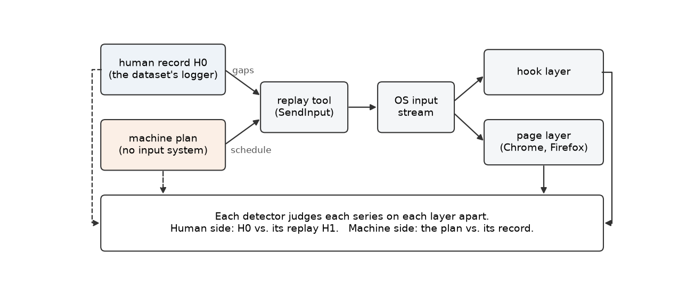
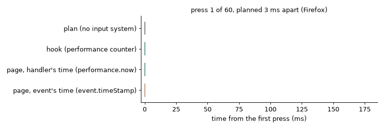
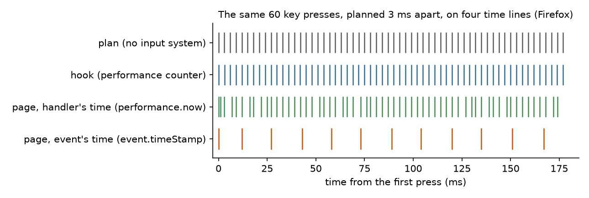

<h1 align="center">打鍵の検出器のための同じ経路の対照</h1>

<p align="center">
  打鍵の時刻から人と機械の入力を見分ける検出器の評価の手順について、<br>
  条件・コード・記録・公開する系列・git の履歴をまとめたものです。
</p>

<p align="center">
  <a href="LICENSE"></a>
  <a href="LICENSE-docs"></a>
  <a href="LICENSE-docs"></a>
  
  <a href="https://docs.astral.sh/uv/"></a>
  
  <a href="https://doi.org/10.5281/zenodo.24403562"></a>
</p>

<p align="center"><a href="README.md">English</a> | <b>日本語</b></p>

この repository は、Mikoto Miura と Yuusuke Harada の論文 *Same-Path Controls for Evaluating Human-versus-Machine Keystroke Detectors* に付くものです。

機械の入力を見分ける検出器は、ふつう、人の打鍵を記録した入力の経路を一度も通っていない機械の会を相手に評価されます。この論文は、1 台の Windows の機械の上で、検出器が使われる経路に 2 つの対の対照を足します。

- 人の記録を、機械と同じ経路で打ち直したもの
- 機械の各会の予定と、その記録

どちらも、値を見る前に決めた規則で読みます。

<p align="center">
  
</p>
<p align="center"><sub>2 つの対の対照（論文の図 1）。予定はどの入力の仕組みも通りません。hook と page は、どの収録も一緒に記録します。</sub></p>

## ロガーの時計は、同じ打鍵をどう刻むか

<p align="center">
  
</p>

公開する系列のうちの 1 つの収録です（`series/v7s/not-kupa-derived/F_K.csv` の単位 `c003`。Firefox で、3 ms おきに予定した打鍵を、hook を入れた状態で記録したもの）。

最初の 60 打鍵を、次の 4 本の時間軸に並べています。

- 予定
- hook（パフォーマンスカウンタ）
- page のハンドラの時刻（`performance.now()`。列 `h_ms`）
- page のイベントの時刻（`event.timeStamp`。列 `t_ms`）

page のイベントの時刻では、短い間のほとんどが 0 になります。ロガーがどの時計を読むかで検出器の判定が変わることは、この論文の事後の解析が見つけたことの 1 つです。下の静止画は、動画の最後のコマです。

<p align="center"></p>

`tools/readme_media.py` が、この 1 つのファイルから両方を描きます。ファイルが manifest の示すバイトと違えば、描かずに止まります。図は説明のためのもので、論文の数はここからは取っていません。この README には、人の記録は 1 つも載せていません。

## 中身

| パス | 中身 |
|---|---|
| `capture/` | 再生と記録の道具（Windows）。`SendInput` での入力、低レベルのキーボードの hook、ブラウザの page、LLM が時刻を決める予定、収録の連なりを走らせた PowerShell のスクリプト（v7 は `capture/chain/` に SHA-256 つきで、v7s は `capture/chain-v7s/`）。 |
| `works/prototype_v7*.py`、`works/conditions/prototype_v7*.json` | 解析とその条件。どれも値の前にコミットしてあります。v7（1 回目）、v7p・v7q・v7r（事後）、v7s（2 回目。新しい収録での基準の検査・査読つき論文の検出器 2 つ・Firefox）、v7t・v7u・v7v（事後）。 |
| `works/conditions/prototype_v7_deviations.md` | 1 回目の逸れの全部（日付つき）。 |
| `results/prototype_v7*/record.json` | 記録。件数・割合・分位点・読みだけです。 |
| `works/export_v7_series.py`、`works/export_v7s_series.py` | 公開する系列の書き出しと、その条件。 |
| `series/v7/`、`series/v7s/` | 公開する系列（下の節）。 |
| `works/prototype_v1.py`〜`v6*.py`、`results/prototype_v1/`〜`v6j/` | 同じ repository の前の版。著者の最初の論文とともに KeepCount（https://doi.org/10.5281/zenodo.23858735）として公開しています。v7 の解析は v4・v5・v6 の一部を読み込みます。 |
| `commit-map.tsv` | 作業用の repository の元のコミットと、ここでのコミットの対応（[履歴](#履歴)）。 |

## 公開する系列

第一著者自身の打鍵を除くすべての収録について、予定した打鍵と、hook と page に記録された打鍵の、種類と時刻です。値は解析が読むとおりで、次の形です。

- 数える種類だけ（`alnum`・`space`・`end`・`enter`・`backspace`・`delete`・`other`）
- 収録の順
- 時刻は各層の最初に数えた打鍵からの ms
- 清掃はしていない

キー・文字・文・人の識別子は書いていません。全セルを許可リストで確かめてから書き出し、戻った後にも確かめ直しました。

| フォルダ | 系列 | 単位（status.csv） | 許諾 |
|---|---|---|---|
| `series/v7/kupa-derived/` | H1_idle・H1_load（各 80 人）、H1_rep（10 人）、M3a・M3b（各 40） | 250 | CC BY-NC-SA 4.0 |
| `series/v7/not-kupa-derived/` | M0・M1_8B・M1_14B・M1_replay_8B・M1_replay_14B・M2_8B・M2_14B（各 40）、P_idle・P_load（各 5）、P_nohook（3） | 293 | CC BY 4.0 |
| `series/v7s/kupa-derived/` | F_H1（10 人、Firefox） | 10 | CC BY-NC-SA 4.0 |
| `series/v7s/not-kupa-derived/` | K_chrome・K_chrome_nohook・F_K_nohook（各 5）、F_K（9）、MC1・MC2・MC3・MC5・F_M0・F_M2_8B・F_M2_14B（各 40） | 304 | CC BY 4.0 |

- **単位の数**: `status.csv` の行の数です。そのうち 2 つには記録の行がありません。v7 の M2_14B `t02` は予定の無いまま失敗し、そのため v7s の F_M2_14B `t02` は `no_plan` です。
- **列**: v7 は `series, unit, layer, i, kind, t_ms`。v7s は `series, unit, layer, i, kind, t_ms, h_ms` です。`h_ms` は page のハンドラの `performance.now()` で、Firefox の系列の page の行にだけ入っています。
- **単位**:
  - `h00…` は、KUPA-KEYS の決まった抽出順での再生した人です（KUPA の識別子は書いていません）。
  - `t00…` は文です（文 *t* は課題 P(*t*+1)）。
  - `c000…c200` は既知の一定の間（ms）です。
- **`status.csv` と `manifest.json`**:
  - `status.csv` は、単位ごとの状態（`captured`・`failed`・`no_plan`）と、やり直したか、予定を公開しているかを示します。
  - `manifest.json` は、ファイルごとの SHA-256・行数・層ごとの打鍵数と、書き出したコミットを示します。
- **KUPA 由来の系列の許諾**: KUPA 由来の系列は、KUPA-KEYS（Velentzas et al., LREC-COLING 2024, https://huggingface.co/datasets/ALTACambridge/KUPA-KEYS）の人のキーを押した時刻を、キーをその種類に置き換えて打ち直したもの（H1・F_H1）か、KUPA の提供者の間をモデルの文に載せたもの（M3）です。KUPA-KEYS の許諾（CC BY-NC-SA 4.0）を継ぎ、出典として KUPA-KEYS を示します。
- **フォルダを確かめるには**: `uv run --frozen python tools/verify_series.py` を使います。2 つのフォルダのそれぞれについて、ファイルを manifest と、書き出しの許可リストと構造と、その run の記録の数と照らします（v7s は `works/export_v7s_series.py --verify`、v7 は `works/export_v7_series.py` の関数を使います）。

## 再現する

```bash
uv sync --frozen
uv run --frozen python tools/original_commits.py   # clone の後に一度: 元のコミットを引けるようにする（履歴）
uv run --frozen pytest -q
```

私たちの Mac では、911 件が通り、10 件が skip されます。5 件は Windows が要るもの、5 件は v6k と v6l の記録が要る v6m のテストです。v6n〜v6s の 6 つのテストのモジュールは、記録が無いと集めません。v7s のテストのうち 2 件は、LightGBM が OpenMP の実行環境を見つけられないと落ちます（`brew install libomp`）。収録の Windows の機械では通りました。

解析とそのテストは、コードと条件を作業用の repository のコミットとハッシュで照らします。`tools/original_commits.py` は、`commit-map.tsv` から git の replace の参照を書き、それらのハッシュをここで引けるようにします。参照が無いと、`tests/conftest.py` がそう知らせ、その照合は落ちます。

1 回目の条件は、最初の収録の前に預けました（https://doi.org/10.5281/zenodo.23939806）。どの解析も、走らせる条件とコードがコミットしたバイトと同じであることを確かめます。

解析そのものは、収録の機械の上で、キーを含む生の収録と KUPA-KEYS を読みます。生の収録は公開しません。KUPA-KEYS は出どころから `external/kupa-keys/` に取ってきます。公開する系列は、収録が解析に渡すものから、キーを除いたものです。

## 履歴

作業用の repository の git の履歴をそのまま残しています。ただし、次の 2 種類のファイルを全コミットから外したので、コミットのハッシュは作業用の repository と違います。`commit-map.tsv` で、元のコミット（記録と論文が名指しするもの）から、ここでのコミットを引けます。外したファイルだけを足していた 14 のコミットは空になったので、ここにも表にもありません。

- v6 の図 6 枚。人ひとりの記録を描いていたもの。
- v6k〜v6s の記録と notes。別の論文に属し、共有しないものです。
  - SHA-256 は `results/record-digests.json` にあり、`tools/rebuild_records.py` が公開データから作り直します。
  - これらが要るテストは、理由を出して skip します（`tests/conftest.py`）。
  - 作り直しには、打鍵のデータを `external/` に置く必要があります。置き方は KeepCount の README（Reproduce）のとおりです。

コミットのメッセージの中のハッシュは、ファイルを外した道具が、ここでのコミットに書き換えました。コード・条件・記録・タグの注釈の中のハッシュは元のものです。この README は、どちらを書いたかを示します。元のハッシュは、`tools/original_commits.py` の後なら完全な形で引けます。短い形では引けないので、`commit-map.tsv` で引いてください。

各記録には、それを作ったコミットにタグがあります。

| タグ | 記録 |
|---|---|
| `record-v7` | 1 回目（v7） |
| `record-v7p`・`record-v7q`・`record-v7r` | 1 回目の事後の解析 |
| `record-v7s` | 2 回目（v7s） |
| `record-v7t`・`record-v7u`・`record-v7v` | 2 回目の事後の解析 |
| `series-export` | 公開する系列を書き出したコード |

v7 の収録の後に、hook の種類の分け方を 1 か所だけ変えました（`capture/hooklog.py`。元のコミット a910372 と 14682a9、ここでは d32fbb6 と 5545514）。

- 変えたこと: Shift を押したままの Space は、`VkKeyScanW` の配列の表には無いため、これまで `nonchar` に分けていました。これを `space` に分けるようにしました（page は前から space と数えていました）。
- 変えていないこと: ほかのキーは変わりません。
- 1 回目への影響: 1 回目の収録と記録は、どれもこの変更の前のコードで作りました。Shift を押したまま Space を打ったのは、第一著者自身の打鍵（block 0。公開しません）の 2 つの収録だけで、block ごと値の前に脇へ除けてあります（逸れ D3）。

## ここに無いもの

第一著者自身の打鍵（系列 L0・L1）、打ったキー・文字・文、KUPA-KEYS の課題文である課題 P1〜P10、KUPA-KEYS の打鍵のデータ、生の収録と走らせたときのログ、v6k〜v6s の記録と notes、v6 の図 6 枚。本研究のために書いた課題 P11〜P40 は、v7 の条件（`works/conditions/prototype_v7.json`。最初の収録の前に預けたもの）の中にあります。

## 許諾

ファイルごとの許諾は `REUSE.toml`（REUSE Specification 3.3）にあり、本文は `LICENSES/`、要約は `LICENSE-docs` にあります。

- コード: MIT
- 文書・条件・v1〜v5 の結果: CC BY 4.0
- v6〜v6j と v7〜v7v の結果: 数えた打鍵のデータの条件を継ぎます
- 公開する系列: CC BY 4.0。KUPA-KEYS から作ったものは CC BY-NC-SA 4.0

## 引用

`CITATION.cff` を見てください。
