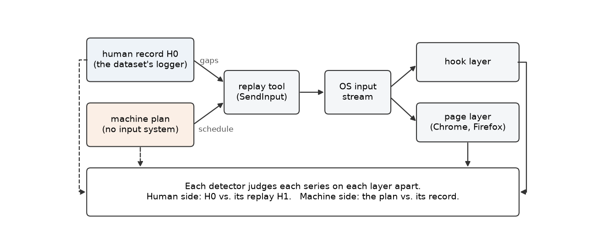
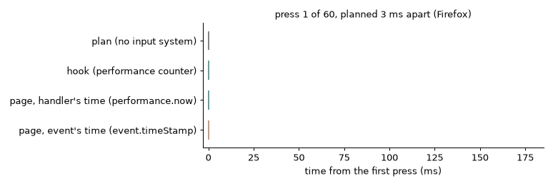
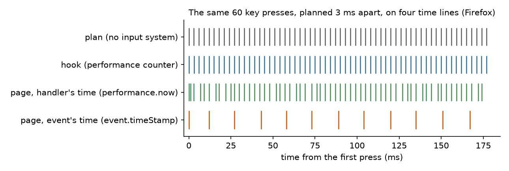

<h1 align="center">Same-path controls for keystroke detectors</h1>

<p align="center">
  Conditions, code, records, released series and git history of an evaluation procedure for detectors that tell<br>
  human from machine typing by keystroke timing.
</p>

<p align="center">
  <a href="LICENSE"></a>
  <a href="LICENSE-docs"></a>
  <a href="LICENSE-docs"></a>
  
  <a href="https://docs.astral.sh/uv/"></a>
  
  <a href="https://doi.org/10.5281/zenodo.24403562"></a>
</p>

<p align="center"><b>English</b> | <a href="README.ja.md">日本語</a></p>

This repository accompanies the article *Same-Path Controls for Evaluating Human-versus-Machine Keystroke Detectors*
by Mikoto Miura and Yuusuke Harada. Detectors of machine typing are usually evaluated against machine sessions that
never passed through the input path that recorded the humans. The article adds two paired controls on the detector's
path, on one Windows machine: the human records replayed through the machine's path, and each machine session's
plan against its recording, read by rules fixed before any value.

<p align="center">
  
</p>
<p align="center"><sub>The two paired controls (Fig. 1 of the article). The plan passes through no input system; the
hook and the page record every capture together.</sub></p>

## What a logger's clock does to the same key presses

<p align="center">
  
</p>

One capture of the released series (`series/v7s/not-kupa-derived/F_K.csv`, unit `c003`: Firefox, presses planned
3 ms apart, hook installed): the first 60 presses on the plan, on the hook (the performance counter) and on the page,
read at the handler's time (`performance.now()`, column `h_ms`) and at the event's time (`event.timeStamp`, column
`t_ms`). On the page's event time, most short gaps become 0. Which clock a logger reads is one of the things the
article's post hoc analyses found to change detectors' judgments. The still below is the last frame.

<p align="center"></p>

`tools/readme_media.py` draws both from that one file and stops unless the file is the bytes its manifest names. The
figures are illustrations: no number of the article comes from them, and no person's record is shown in this README.

## What is here

| Path | What |
|---|---|
| `capture/` | The replay and recording tools (Windows): `SendInput` injection, the low-level keyboard hook, the browser page, the LLM-timed plans, and the PowerShell scripts that ran the chains of captures (`capture/chain/` for v7 with their SHA-256, `capture/chain-v7s/` for v7s). |
| `works/prototype_v7*.py`, `works/conditions/prototype_v7*.json` | The analyses and their conditions, each committed before its values: v7 (first round), v7p, v7q, v7r (post hoc), v7s (second round: the criterion tested on new captures, two detectors from peer-reviewed papers, Firefox), v7t, v7u, v7v (post hoc). |
| `works/conditions/prototype_v7_deviations.md` | Every deviation of the first round, dated. |
| `results/prototype_v7*/record.json` | The records: counts, shares, quantiles and readings only. |
| `works/export_v7_series.py`, `works/export_v7s_series.py` | The export of the released series, and their conditions. |
| `series/v7/`, `series/v7s/` | The released series (below). |
| `works/prototype_v1.py` to `v6*.py`, `results/prototype_v1/` to `v6j/` | Earlier runs of the same repository, archived with the authors' first article as KeepCount (https://doi.org/10.5281/zenodo.23858735). The v7 analyses import parts of v4, v5 and v6. |
| `commit-map.tsv` | The original commit of the working repository → the commit here (see [History](#history)). |

## The released series

For every capture except the first author's own typing, the kinds and times of the key presses planned and recorded
on the hook and on the page, as the analyses read them: counted kinds only (`alnum`, `space`, `end`, `enter`,
`backspace`, `delete`, `other`), in capture order, times in ms from the layer's first counted press, with no cleaning.
No key, character, text or person identifier is written; every cell was checked against an allow-list before the
files were written, and again on return.

| Folder | Series | Units (status.csv) | Licence |
|---|---|---|---|
| `series/v7/kupa-derived/` | H1_idle, H1_load (80 persons each), H1_rep (10), M3a, M3b (40 each) | 250 | CC BY-NC-SA 4.0 |
| `series/v7/not-kupa-derived/` | M0, M1_8B, M1_14B, M1_replay_8B, M1_replay_14B, M2_8B, M2_14B (40 each), P_idle, P_load (5 each), P_nohook (3) | 293 | CC BY 4.0 |
| `series/v7s/kupa-derived/` | F_H1 (10 persons, Firefox) | 10 | CC BY-NC-SA 4.0 |
| `series/v7s/not-kupa-derived/` | K_chrome, K_chrome_nohook, F_K_nohook (5 each), F_K (9), MC1, MC2, MC3, MC5, F_M0, F_M2_8B, F_M2_14B (40 each) | 304 | CC BY 4.0 |

- Units count the rows of `status.csv`. Two of them have no recorded rows: M2_14B `t02` failed without a plan in v7,
  and F_M2_14B `t02` (v7s) is `no_plan` for that reason.
- Columns: `series, unit, layer, i, kind, t_ms` (v7) and `series, unit, layer, i, kind, t_ms, h_ms` (v7s; `h_ms`,
  the page handler's `performance.now()`, only on the page rows of the Firefox series).
- Units: `h00…` a replayed person in the fixed draw order of KUPA-KEYS (no KUPA identifier), `t00…` a text
  (text *t* is prompt P(*t*+1)), `c000…c200` a known constant gap in ms.
- `status.csv` gives each unit's status (`captured`, `failed`, `no_plan`), whether it was redone, and whether its plan
  is released; `manifest.json` gives each file's SHA-256, rows and presses per layer, and the commit that wrote it.
- The KUPA-derived series replay the key-down times of persons in KUPA-KEYS (Velentzas et al., LREC-COLING 2024,
  https://huggingface.co/datasets/ALTACambridge/KUPA-KEYS) with the keys replaced by their kinds (H1, F_H1), or place
  KUPA donors' gaps on a model's text (M3); they keep its licence, CC BY-NC-SA 4.0, with attribution to KUPA-KEYS.
- To check both folders: `uv run --frozen python tools/verify_series.py`. For each, the files against its manifest,
  the allow-list and structure of its export, and the counts of its run's record (v7s's check is
  `works/export_v7s_series.py --verify`; v7's uses the functions of `works/export_v7_series.py`).

## Reproduce

```bash
uv sync --frozen
uv run --frozen python tools/original_commits.py   # once after cloning: the original commits resolve (History)
uv run --frozen pytest -q
```

On our Mac this gives 911 passed and 10 skipped: five tests need Windows, and five of v6m need the records of v6k and
v6l; the six test modules of v6n to v6s are not collected without those records. Two tests of v7s fail there unless
LightGBM finds the OpenMP runtime (`brew install libomp`); they passed on the Windows machine of the captures. The analyses and their tests check the code and conditions against commits of the working repository by
hash; `tools/original_commits.py` writes git replace refs from `commit-map.tsv` so that those hashes resolve here
(without them, `tests/conftest.py` says so and those checks fail).

The conditions of the first round were deposited before its first capture (https://doi.org/10.5281/zenodo.23939806),
and every analysis checks that the conditions and code it runs are the committed bytes. The analyses themselves read
the raw captures (with keys) and KUPA-KEYS on the capture machine; the raw captures are not released, and KUPA-KEYS is
obtained from its source into `external/kupa-keys/`. The released series are what the captures give the analyses,
without keys.

## History

The git history of the working repository is kept. Files are removed from every commit, so commit
hashes differ from the working repository's; `commit-map.tsv` maps each original commit (as the records and the
article name them) to the commit here. The 14 commits that only added removed files became empty and are not here or
in the map. Two kinds of files are removed:

- six figures of run v6 that drew single persons' records;
- the records and notes of runs v6k to v6s, which belong to another article and are not shared; their SHA-256 are in
  `results/record-digests.json` and `tools/rebuild_records.py` rebuilds them from the public data. Tests that need
  them are skipped with the reason (`tests/conftest.py`). Rebuilding needs the keystroke data in `external/`, placed as
  in KeepCount's README (Reproduce).

Hashes in commit messages were rewritten to the commits here by the tool that removed the files; hashes in the code,
conditions, records and tag annotations are the original ones, and this README says which it gives. Full original hashes resolve here after
`tools/original_commits.py`; short ones do not (look them up in `commit-map.tsv`).

Each record has a tag on the commit that produced it:

| Tag | Record |
|---|---|
| `record-v7` | first round (v7) |
| `record-v7p`, `record-v7q`, `record-v7r` | post hoc analyses of the first round |
| `record-v7s` | second round (v7s) |
| `record-v7t`, `record-v7u`, `record-v7v` | post hoc analyses of the second round |
| `series-export` | the code that wrote the released series |

After the captures of v7, the hook's classifier was changed in one place (`capture/hooklog.py`, original commits
a910372 and 14682a9, here d32fbb6 and 5545514): a Space pressed while Shift is held, which the layout table from `VkKeyScanW` does not map, is
now classed as `space` (the page already counted it as space) instead of `nonchar`. No other key changes. Every
capture and record of the first round was made with the code before this change. Shift was held over Space only in
two captures of the first author's own typing (block 0, not released), set aside with their block before any value
(deviation D3).

## What is not here

The first author's own typing (series L0, L1); any key, character or text typed; the prompts P1 to P10, which are the
task prompts of KUPA-KEYS; the keystroke data of KUPA-KEYS; the raw captures and run logs; the records and notes of
v6k to v6s; and the six figures of v6. The prompts P11 to P40, written for this study, are in the conditions of v7
(`works/conditions/prototype_v7.json`, deposited before the first capture).

## Licences

Stated file by file in `REUSE.toml` (REUSE Specification 3.3), texts in `LICENSES/`, summary in `LICENSE-docs`: code
MIT; documents, conditions and the results of runs v1 to v5 CC BY 4.0; the results of runs v6 to v6j and v7 to v7v
keep the terms of the keystroke data they count; the released series CC BY 4.0, or CC BY-NC-SA 4.0 where made from
KUPA-KEYS.

## Citation

See `CITATION.cff`.
